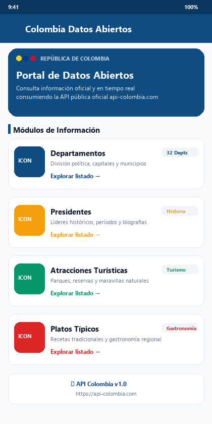
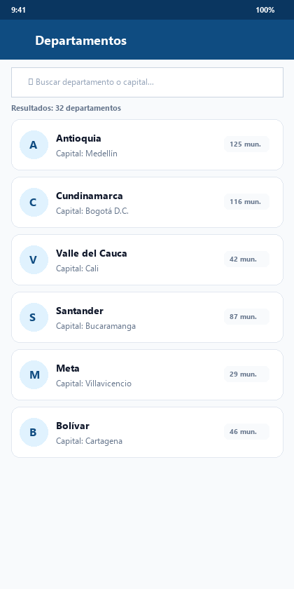
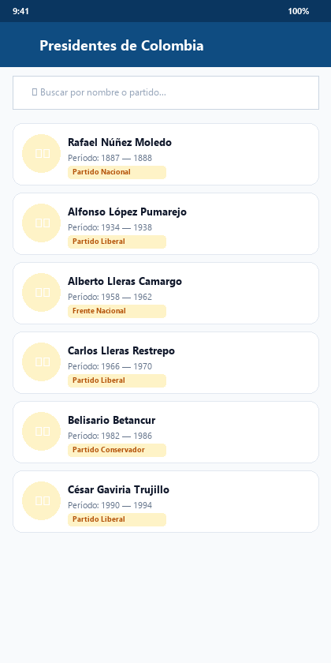
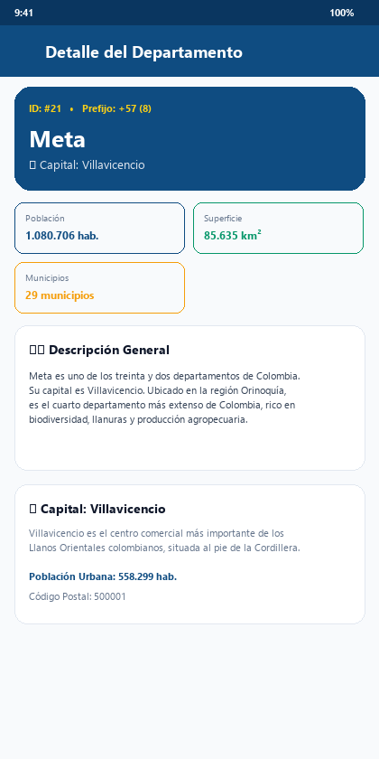
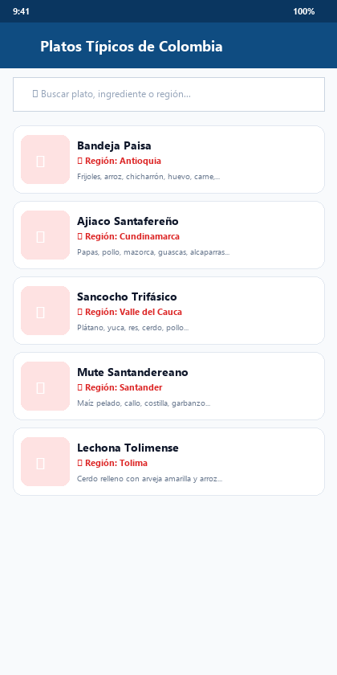
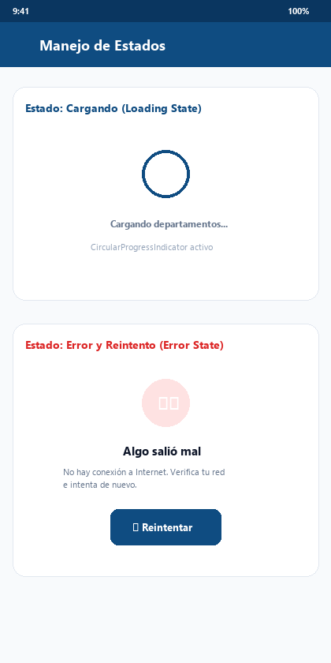

# 🇨🇴 Datos Abiertos de Colombia — Taller Flutter (Electiva Profesional I)

Aplicación móvil desarrollada en **Flutter** para el consumo y visualización de datos abiertos de la República de Colombia a través de la API pública oficial **[API Colombia](https://api-colombia.com/)**.

Este proyecto implementa una arquitectura limpia por capas (Model-View-Service), navegación declarativa avanzada mediante **`go_router`**, manejo centralizado de variables de entorno con **`flutter_dotenv`**, consumo HTTP robusto con **`http`**, y control integral de estados de interfaz (cargando, éxito, error con reintento y filtros en tiempo real).

---

## 📌 Enlaces del Proyecto y API

- **API Base:** [https://api-colombia.com/api/v1](https://api-colombia.com/api/v1)
- **Documentación Swagger:** [https://api-colombia.com/swagger/index.html](https://api-colombia.com/swagger/index.html)
- **Repositorio Oficial:** [https://github.com/brahiantenorio/-taller_datos_abiertos](https://github.com/brahiantenorio/-taller_datos_abiertos)
- **Ramas del Repositorio:**
  - `main`: Código estable y validado para producción.
  - `dev`: Rama de integración de características.
  - `feature/taller_api_colombia`: Rama de desarrollo del taller (commits atómicos).

---

## 🚀 Endpoints Consumidos (4 Módulos)

Se seleccionaron 4 endpoints representativos y ricos en información de la API de Colombia:

| Módulo | Endpoint Base | Endpoint Detalle | Descripción |
| :--- | :--- | :--- | :--- |
| **1. Departamentos** | `GET /Department` | `GET /Department/{id}` | División territorial de Colombia, capitales, superficie, población y cantidad de municipios. |
| **2. Presidentes** | `GET /President` | `GET /President/{id}` | Líderes históricos de Colombia, períodos de mandato, partido político y biografías. |
| **3. Atracciones Turísticas** | `GET /TouristicAttraction` | `GET /TouristicAttraction/{id}` | Destinos turísticos oficiales, parques nacionales, coordenadas geográficas y fotografías. |
| **4. Platos Típicos** | `GET /TypicalDish` | `GET /TypicalDish/{id}` | Gastronomía típica colombiana, recetas, ingredientes clave, fotografías y departamento de origen. |

---

## 📐 Arquitectura y Estructura del Proyecto

El proyecto sigue estrictamente la separación de responsabilidades planteada en el taller:

```text
lib/
├── config/                  // Configuración global y variables de entorno
│   ├── app_config.dart      // Carga y lectura segura de .env con valores de respaldo
│   └── constants.dart       // Constantes de endpoints y nombres de rutas
├── models/                  // Modelos fuertemente tipados con fromJson y toJson
│   ├── department_model.dart
│   ├── president_model.dart
│   ├── touristic_attraction_model.dart
│   └── typical_dish_model.dart
├── routes/                  // Configuración de rutas declarativas con go_router
│   └── app_router.dart      // Rutas con nombre, parámetros :id y payloads extra
├── services/                // Capa de infraestructura y llamadas HTTP
│   └── api_service.dart     // Cliente HTTP, ApiException, validación de status codes y timeouts
├── themes/                  // Estilos y tema visual Material 3
│   └── app_theme.dart       // Paleta de colores colombiana, cards, tipografía y badges
├── views/                   // Pantallas de la aplicación (Dashboard, Listados, Detalles)
│   ├── dashboard/
│   │   └── dashboard_view.dart
│   ├── departments/
│   │   ├── departments_list_view.dart
│   │   └── department_detail_view.dart
│   ├── presidents/
│   │   ├── presidents_list_view.dart
│   │   └── president_detail_view.dart
│   ├── attractions/
│   │   ├── attractions_list_view.dart
│   │   └── attraction_detail_view.dart
│   └── dishes/
│       ├── dishes_list_view.dart
│       └── dish_detail_view.dart
├── widgets/                 // Componentes UI desacoplados y reutilizables
│   ├── empty_state_widget.dart
│   ├── error_view_widget.dart
│   ├── loading_widget.dart
│   ├── network_image_with_fallback.dart
│   ├── search_bar_widget.dart
│   └── stat_badge_widget.dart
└── main.dart                // Punto de entrada de la aplicación Flutter
```

---

## 📦 Paquetes Utilizados

- **`http: ^1.6.0`**: Cliente para la realización de peticiones HTTP REST con decodificación UTF-8, cabeceras personalizadas y manejo de excepciones de red.
- **`go_router: ^18.1.1`**: Enrutador declarativo para Flutter que gestiona URLs tipo web, rutas anidadas, nombres (`name`), parámetros de ruta (`:id`) y paso de objetos (`extra`).
- **`flutter_dotenv: ^6.0.1`**: Carga de configuración sensible y URLs base desde el archivo `.env`.

---

## 🧭 Configuración de Rutas con `go_router`

El enrutamiento se encuentra configurado en `lib/routes/app_router.dart`:

| Nombre de Ruta (`name`) | Trayectoria (`path`) | Parámetros Enviados | Pantalla Asociada |
| :--- | :--- | :--- | :--- |
| `dashboard` | `/` | Ninguno | `DashboardView` |
| `departments` | `/departments` | Ninguno | `DepartmentsListView` |
| `department-detail` | `/departments/:id` | `:id` (path) + `DepartmentModel` (extra) | `DepartmentDetailView` |
| `presidents` | `/presidents` | Ninguno | `PresidentsListView` |
| `president-detail` | `/presidents/:id` | `:id` (path) + `PresidentModel` (extra) | `PresidentDetailView` |
| `attractions` | `/attractions` | Ninguno | `AttractionsListView` |
| `attraction-detail` | `/attractions/:id` | `:id` (path) + `TouristicAttractionModel` (extra) | `AttractionDetailView` |
| `dishes` | `/dishes` | Ninguno | `DishesListView` |
| `dish-detail` | `/dishes/:id` | `:id` (path) + `TypicalDishModel` (extra) | `DishDetailView` |

> **Nota sobre el patrón Maestro-Detalle:** Cuando se navega desde el listado, el objeto modelo se envía en la propiedad `extra` para una transición instantánea y fluida sin parpadeos. Si el usuario accede por enlace directo (o recarga en Web), la vista de detalle extrae el `:id` y realiza la petición HTTP individual al servicio `get...ById(id)`.

---

## 🖼️ Capturas de Pantalla y Evidencias Visuales

### 1. Dashboard Principal y Listados
| Dashboard Principal | Listado de Departamentos | Listado de Presidentes |
| :---: | :---: | :---: |
|  |  |  |

### 2. Pantallas de Detalle (Maestro-Detalle) y Gastronomía
| Detalle de Departamento | Listado de Platos Típicos | Manejo de Estados (Carga / Error) |
| :---: | :---: | :---: |
|  |  |  |

---

## ⚡ Manejo de Estados y Excepciones

Cada pantalla implementa 3 estados visuales claros:
1. **Cargando (`LoadingState`):** Spinner centrado (`CircularProgressIndicator`) con mensaje descriptivo mientras se ejecuta la petición HTTP asíncrona.
2. **Éxito (`SuccessState`):** Renderizado de tarjetas con `ListView.builder`, buscador interactivo en tiempo real con filtrado instantáneo y pull-to-refresh (`RefreshIndicator`). Si el filtro no arroja resultados, se presenta un `EmptyStateWidget`.
3. **Error (`ErrorState`):** Captura de `ApiException`, errores de conexión (`SocketException`) o timeouts mediante `ErrorViewWidget` con icono de alerta, mensaje amigable en español y botón interactivo **"Reintentar"** para reintentar la solicitud sin reiniciar la app.

---

## 📄 Ejemplos de Respuestas JSON de la API

### 1. Departamento (`GET /api/v1/Department/21`)
```json
{
  "id": 21,
  "name": "Meta",
  "description": "Meta es uno de los treinta y dos departamentos que, junto con Bogotá, forman la República de Colombia. Su capital es Villavicencio...",
  "cityCapitalId": 740,
  "municipalities": 29,
  "surface": 85635,
  "population": 1080706,
  "phonePrefix": "8",
  "cityCapital": {
    "id": 740,
    "name": "Villavicencio",
    "description": "Villavicencio es un municipio colombiano, capital del departamento del Meta...",
    "surface": 1338,
    "population": 558299,
    "postalCode": "500001"
  }
}
```

### 2. Presidente (`GET /api/v1/President/3`)
```json
{
  "id": 3,
  "image": "https://upload.wikimedia.org/wikipedia/commons/d/db/Rafael_Nunez.JPG",
  "name": "Rafael",
  "lastName": "Nuñez Moledo",
  "startPeriodDate": "1887-06-04",
  "endPeriodDate": "1888-08-07",
  "politicalParty": "Partido nacional",
  "description": "Rafael Wenceslao Núñez Moledo fue un abogado, periodista, político y militar colombiano..."
}
```

### 3. Plato Típico (`GET /api/v1/TypicalDish/1`)
```json
{
  "id": 1,
  "name": "Bandeja Paisa",
  "description": "La bandeja paisa es el orgullo de la cocina paisa y uno de los platos más emblemáticos de Colombia...",
  "ingredients": "Frijoles, arroz, carne molida, chicharrón, huevo, plátano maduro, chorizo, arepa, aguacate.",
  "imageUrl": "https://apicolombiastorage.blob.core.windows.net/typicaldishes/1. Bandeja Paisa.jpg",
  "departmentId": 2,
  "department": {
    "id": 2,
    "name": "Antioquia"
  }
}
```

---

## 🧪 Pruebas Automatizadas

El proyecto cuenta con suites de pruebas unitarias y de widgets en el directorio `test/`:
- `test/models_test.dart`: Validación de serialización/deserialización `fromJson` y `toJson` para todos los modelos y métodos auxiliares.
- `test/api_service_test.dart`: Simulación de respuestas HTTP con `MockClient` (éxito 200, no encontrado 404, error interno 500 y excepciones personalizadas).
- `test/widget_test.dart`: Prueba de renderizado de componentes clave en el Dashboard.

Para ejecutar los tests:
```bash
flutter test
```

---

## 🛠️ Instrucciones de Ejecución Local

1. **Clonar el repositorio:**
   ```bash
   git clone https://github.com/brahiantenorio/-taller_datos_abiertos.git
   cd -taller_datos_abiertos
   ```

2. **Instalar dependencias de Flutter:**
   ```bash
   flutter pub get
   ```

3. **Verificar variables de entorno:**
   Asegúrese de que el archivo `.env` exista en la raíz con el siguiente contenido:
   ```env
   API_BASE_URL=https://api-colombia.com/api/v1
   APP_NAME=Colombia Datos Abiertos
   ```

4. **Ejecutar la aplicación:**
   ```bash
   flutter run -d chrome
   # o en dispositivo Android / Windows:
   flutter run
   ```

---

## 🌿 Flujo GitFlow Implementado

Siguiendo las pautas de control de versiones:
1. `main`: Rama de código de producción.
2. `dev`: Rama de integración donde se consolidan las características.
3. `feature/taller_api_colombia`: Rama donde se desarrollaron los commits atómicos:
   - `chore: initial flutter project setup and repository structure`
   - `chore: add dependencies (http, go_router, flutter_dotenv) and configure .env asset loading`
   - `feat: implement environment configuration and theme setup with Material 3`
   - `feat: create data models for Department, President, TouristicAttraction, and TypicalDish`
   - `feat: implement ApiService with robust error handling and status code verification`
   - `feat: build reusable UI widgets (loading indicator, error view, custom card, search bar)`
   - `feat: configure go_router declarative routing with named routes and parameters`
   - `feat: implement Dashboard screen with interactive endpoint introduction cards`
   - `feat: implement List and Detail views with state handling for Departments, Presidents, Attractions, and Dishes`
   - `refactor: refine app theme and widgets with safe null-checks and modern color specifications`
   - `test: add comprehensive unit tests for models, api service, and widget rendering`
   - `docs: add comprehensive README with architecture, endpoints, routes, and screenshots`

---

**Autor:** Brahian Andres Tenorio  
**Materia:** Móviles con Flutter — Electiva Profesional I  
**Institución:** Universidad  
